# Reiss Family Recipes — User Guide

Welcome to the **Reiss Family Recipes** user guide. This guide walks through every feature of the website step by step—from finding a recipe for tonight's dinner, to hands-free cooking with voice timers, planning a week of meals, shopping at the store, submitting new recipes, and tracking grocery receipts.

---

## Table of Contents

1. [Getting Around the Site](#1-getting-around-the-site)
2. [Browsing, Searching, Filtering, and Sorting Recipes](#2-browsing-searching-filtering-and-sorting-recipes)
3. [Viewing a Recipe](#3-viewing-a-recipe)
4. [Cook Mode, Kitchen Timers, Voice Alarm, and Read-Aloud](#4-cook-mode-kitchen-timers-voice-alarm-and-read-aloud)
5. [Meal Planner](#5-meal-planner)
6. [Shopping List](#6-shopping-list)
7. [Submitting Recipes and the Recent Submissions Log](#7-submitting-recipes-and-the-recent-submissions-log)
8. [Adding, Editing, and Deleting Recipes (Plus Change History)](#8-adding-editing-and-deleting-recipes-plus-change-history)
9. [Receipts and Price History Lookup](#9-receipts-and-price-history-lookup)
10. [How the System Works (Architecture Overview)](#10-how-the-system-works-architecture-overview)
11. [Screenshot Shot List](#11-screenshot-shot-list)

---

## 1. Getting Around the Site

### Opening the Home Page
1. Open the website in your phone, tablet, or computer browser (`#/`).
   - **Tip (What is a URL hash?):** The part of the web address starting with `#/` (such as `#/recipes` or `#/planner`) tells the browser which screen of the site to show without reloading the whole page.
2. At the top of every screen is the **Header Bar**:
   - Tap **Reiss Family Recipes** on the left at any time to return to the home landing page (`#/`).
   - Use the four navigation links on the right to jump to any area of the site:
     - **Recipes** (`#/recipes`)
     - **Meal Planner** (`#/planner`)
     - **Shopping List** (`#/shopping`)
     - **Receipts** (`#/receipts`)
3. Below the header on the home landing page, you will see:
   - Three summary cards—**Recipes** (showing the total number of recipes in the collection), **Meal Planner** (showing how many meals are planned this week), and **Shopping List** (showing how many items are left to buy). Tap any card to open that section.
   - A **This week** strip showing each day (`Sun` through `Sat`) and a **Open planner →** link.

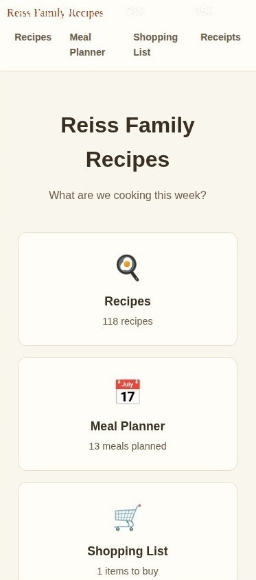

---

## 2. Browsing, Searching, Filtering, and Sorting Recipes

Tap **Recipes** in the top navigation bar (or the **Recipes** card on the home page) to open the recipe collection (`#/recipes`).

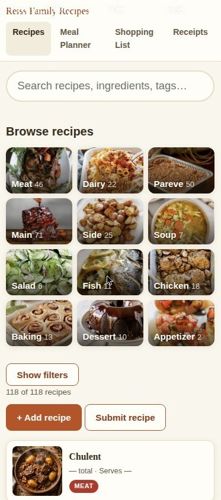

### Searching with Instant Suggestions and Grouped Results
1. Tap the search box under **What are we cooking?** (`Search recipes, ingredients, tags…`).
2. Start typing a recipe name, ingredient, or tag:
   - **Instant Suggestions Dropdown:** Immediately below the search box, a flat dropdown list appears showing up to 8 matching recipes—with title matches listed first and each recipe's total time on the right.
     - Tap any suggestion in the dropdown (or use the `Down` / `Up` arrow keys and press `Enter`) to open that recipe right away.
     - Press `Escape` (or tap outside the box) to close the dropdown and browse the full grid below.

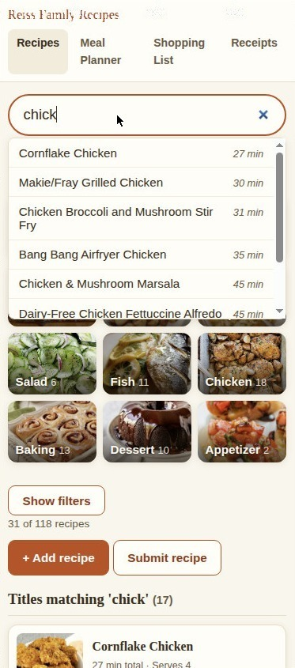

3. **Grouped Search Results in the Grid:** Whenever a search query is active in the search box, the recipe grid below splits into up to three labeled sections so you can tell *why* each recipe matched:
   - **Titles matching '<your search>' (N)** — Recipes whose title contains your search words, listed first.
   - **With '<your search>' as an ingredient (N)** — Recipes whose title does not contain the search words, but that use your search term in their ingredients list.
   - **More matches (N)** — Recipes that matched in their tags, categories, or recipe notes.
   - Within each section, recipes remain sorted by your chosen time order. Clearing the search box returns the grid to a single unified list.

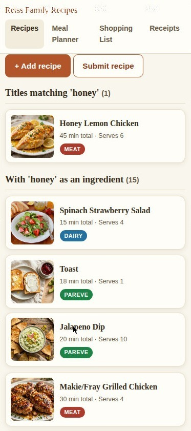

### Using the Quick-Filter Category Tiles
1. Under **Browse recipes**, tap any picture tile to filter the collection with one tap:
   - **Kosher status tiles:** `Meat`, `Dairy`, `Pareve`
   - **Category tiles:** `Main`, `Side`, `Soup`, `Salad`, `Fish`, `Chicken`, `Baking`, `Dessert`, `Appetizer` (each tile displays the number of recipes in that group).
2. Tapping a tile automatically updates the matching filter dropdown below and smoothly scrolls the page down to the filtered recipe grid.

### Filtering and Sorting the Grid
1. On phone screens, tap the **Show filters** button above the recipe count to expand the filter controls (tap **Hide filters** to collapse them again). On wider tablet and desktop screens, the filter bar is always visible.

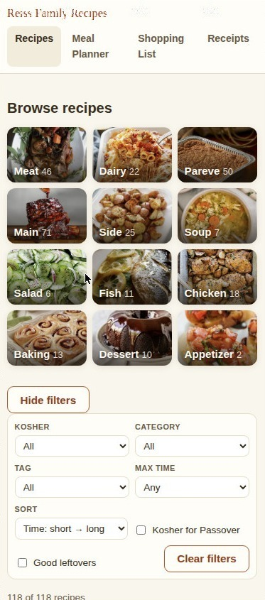

2. Use any combination of controls to narrow down the recipes shown:
   - **Kosher:** Choose `All`, `Meat`, `Dairy`, or `Pareve`.
   - **Category:** Choose `All` or a specific dish category (such as `main`, `side`, `soup`, `salad`, `fish`, `chicken`, `meat`, `dessert`, `baking`, `breakfast`).
   - **Tag:** Choose `All` or any descriptive tag in the collection.
   - **Max time:** Limit results by total prep + cook time (`Any`, `≤ 15 min`, `≤ 30 min`, `≤ 45 min`, `≤ 60 min`, `≤ 90 min`, or `≤ 120 min`).
   - **Sort:** Choose `Time: short → long` (default) or `Time: long → short`.
   - **Kosher for Passover:** Check this box to show only recipes marked Kosher for Passover (`KFP`).
   - **Good leftovers:** Check this box to show only recipes marked as making good leftovers.
3. The counter below the filters (`X of Y recipes`) updates immediately as you change any filter.
4. To reset everything—including your search text, tile selection, dropdowns, checkboxes, and sort order—tap **Clear filters**.

---

## 3. Viewing a Recipe

Tap any recipe card in the grid to open its detail page (`#/recipe/<id>`).

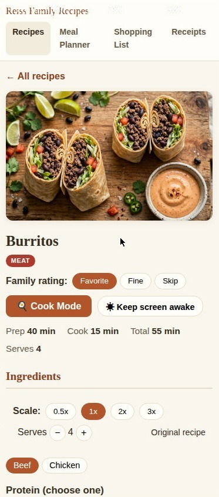) showing the banner, title, kosher badge, Family rating buttons, Cook Mode bar, Prep/Cook/Total/Serves summary strip, and Ingredients section" width="373">

### Reading the Recipe Header
1. At the top left, tap **← All recipes** at any time to go back to the recipe list (if you came from a search or filter, your search and filters remain intact).
2. Beneath the recipe banner and title, you will find:
   - **Kosher Badges:** `MEAT` (red), `DAIRY` (blue), or `PAREVE` (green)—meaning neither meat nor dairy—plus a `KFP` badge if the recipe is Kosher for Passover.
   - **Family rating:** Three buttons—**Favorite**, **Fine**, and **Skip**.
     - Tap a button to set the shared family rating for this dish (used by the Meal Planner when drafting a week).
     - Tap the currently highlighted button a second time to clear the rating back to unrated.
   - **Cook Mode & Screen Awake Bar:**
     - **🍳 Cook Mode** opens the full-screen kitchen view (covered in [Section 4](#4-cook-mode-kitchen-timers-voice-alarm-and-read-aloud)).
     - **☀ Keep screen awake** prevents your phone or tablet screen from dimming or locking while you read the recipe (`☀ Screen awake: On`). Tap it again to turn it off. (If your browser does not support screen wake locks, a small note says `Screen wake lock not supported on this browser`.)
   - **Kosher Review Banner (when applicable):** If a recipe was imported from an outside source with an ingredient that needs checking, a yellow banner appears: `⚠️ Potential kosher issues — review needed.` along with a note describing what to check.
   - **Time & Yield Strip:** Shows **Prep**, **Cook**, **Total** time, and **Serves**.

### Scaling Servings (`0.5x`, `1x`, `2x`, `3x`, or Custom Servings)
1. In the **Ingredients** section, locate the **Scale:** bar.
2. Tap a preset multiplier—**0.5x**, **1x**, **2x**, or **3x**—to halve, restore, double, or triple all ingredient quantities on the page.
3. If the recipe has a numeric serving count (such as `Serves 6` or `Serves 6-8`), you can also tap the **−** and **+** buttons next to **Serves** to scale the recipe to any exact number of servings.
4. While scaled:
   - Every ingredient quantity and unit updates automatically (including fractions like `1 1/2 cups`, singular/plural words like `1 onion` vs. `2 onions`, and `"a pinch"` for tiny scaled amounts).
   - The status text at the end of the scale bar shows `Showing <factor>x · <N> servings` (or `Original recipe` at `1x`), and the **Serves** number in the recipe header updates to match.
   - Scaling is temporary for your current viewing session and resets to `1x` when you leave the recipe.

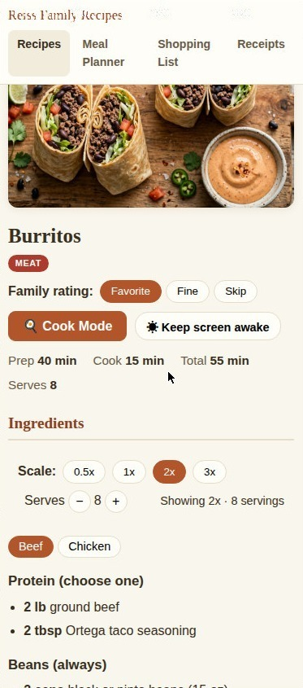

### Switching Recipe Versions (Variants)
Some recipes can be made in more than one version (for example, a dish with a **Beef** version and a **Chicken** version).
1. When a recipe has multiple versions, a row of **version pills** appears right below the Scale bar.
2. Tap the version you want to make:
   - The ingredients list updates immediately to show the shared ingredients (used in every version) plus only the ingredients for your selected version.
   - Any active serving scale (`2x`, etc.) applies automatically to the selected version.

### Instructions, Pairings, Leftovers, PDFs, and Sharing
1. **Instructions:** Numbered steps appear below the ingredients. Any cooking duration mentioned in a step is turned into a tappable **⏱ timer pill** (covered in [Section 4](#4-cook-mode-kitchen-timers-voice-alarm-and-read-aloud)).
2. **Pairings:** If the recipe has suggested companion dishes in the collection, a **Pairings** section lists clickable links to those recipes along with a short note.
3. **Leftovers:** A box under **Leftovers** shows either `✓ Good for leftovers.` (or a specific storage/reheating note) or `✗ Best eaten fresh.`
4. **Bottom Action Buttons:** Scroll to the bottom of the recipe to find:
   - **Edit** — Opens the recipe editor (`#/edit/<id>`).
   - **View PDF** — Opens the formatted, one-page **Recipe Press PDF** (`pdfs/<id>.pdf`) in a new tab.
   - **Share** — On phones and tablets that support file sharing, shares the formatted PDF file directly; on other devices, downloads the PDF (or copies the recipe link if no PDF exists).
   - **Print / PDF** — Opens your browser's print dialog (formatted cleanly without navigation bars or buttons).
   - **Delete recipe** — Opens a separate confirmation screen (`#/delete/<id>`) so a recipe can never be deleted by a single accidental tap.

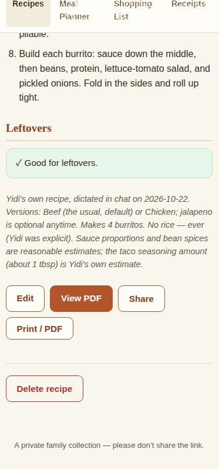

---

## 4. Cook Mode, Kitchen Timers, Voice Alarm, and Read-Aloud

### Launching Big-Screen Cook Mode
1. On any recipe detail page, tap **🍳 Cook Mode** near the top.
2. The screen switches to a full-screen kitchen workspace designed to be read from across the counter and tapped with wet or floury knuckles:
   - **On wide screens (tablets, laptops, smart displays):** A two-pane split shows the checkable **Ingredients** list on the left and the current **Step** in large type on the right.
   - **On phones:** The current **Step** fills the screen; tap **📋 Ingredients** in the top bar whenever you want to slide open the ingredients drawer, and tap **Hide Ingredients** to close it.
3. Entering Cook Mode automatically turns on **Keep screen awake** (`☀ Screen awake: On`) for up to 2 hours so your screen won't go dark mid-recipe.

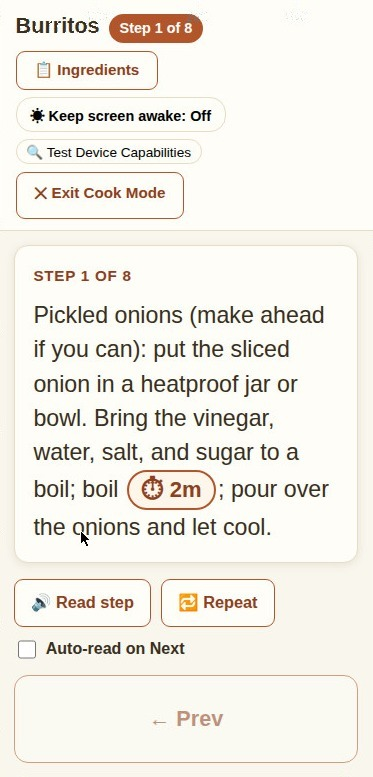

### Navigating Steps and Checking Off Ingredients in Cook Mode
1. **Check off ingredients as you prep:** Tap any ingredient in the Cook Mode ingredients list to mark it with a `✓` checkmark. Tap it again to uncheck.
2. **Scale or switch versions in place:** Use the **Scale: 0.5x 1x 2x 3x** buttons or version pills at the top of the Cook Mode ingredients pane; your changes stay synced with the recipe page underneath.
3. **Move between steps:**
   - Tap the large **Next Step →** button at the bottom right to advance (on the final step, this button says **✓ Done cooking** and closes Cook Mode).
   - Tap **← Prev** at the bottom left to go back a step.
   - On touchscreens, you can also **swipe left** on the step card for the next step or **swipe right** for the previous step.
   - On a keyboard, press `Right Arrow` / `Left Arrow` to change steps, or `Escape` to exit.
4. To leave Cook Mode at any time, tap **✕ Exit Cook Mode** in the top-right corner.

### Using Tap-to-Start Kitchen Timers
1. Whenever a recipe step mentions a time—such as `"simmer for 20 minutes"` or `"bake 30 to 40 minutes"`—it appears as a tappable button: **⏱ 20m** or **⏱ 30m–40m (30m)**.
   - For time ranges, the timer starts at the lower number (30 minutes) so you can check doneness early, while the label reminds you of the full range (`30m–40m`).
2. Tap any **⏱** pill (either inside Cook Mode or on the regular recipe page) to start that countdown immediately.
3. The **Active Timers** dock (`⏱ Active Timers (N)`) appears pinned to the bottom of your screen:
   - You can run multiple timers at once (even from different steps or different recipes).
   - Timers stay visible at the bottom of the screen if you exit Cook Mode or browse to other pages on the site, and they automatically recover if you refresh your browser tab.
4. On each running timer card in the dock, you can tap:
   - **⏸ Pause** (and **▶ Resume** when paused)
   - **+1m**, **+5m**, or **+10m** to add 1, 5, or 10 minutes to the countdown at any time
   - **Reset** to reset the timer back to its starting duration (paused)
   - **✕** to remove the timer

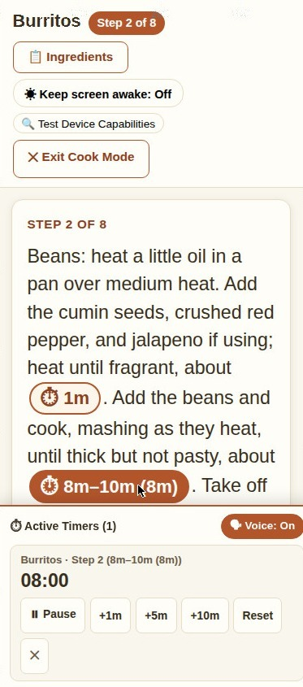

### Spoken Voice Alarm When a Timer Finishes
1. When a timer reaches `00:00`:
   - The timer card highlights and begins counting up overtime (`00:00 · Done! +00:07`) so you can see how long ago it finished.
   - If **Voice** is on, your device speaks a clear voice alarm aloud:
     > *"Kitchen timer! Kitchen timer! Step 5, 30 to 40 minutes is done."*
   - **Why a spoken voice alarm instead of a beep?** On kitchen smart displays (such as an Echo Show), playing a tone or audio file stops background music and can exit the browser when you ask the speaker to resume music. The browser's spoken voice alarm talks right over your music without pausing it.
2. The spoken alarm repeats every **7 seconds** (for up to 5 minutes of overtime) until you acknowledge it:
   - Tap the large **✓ Dismiss** button on the finished timer card to clear it.
   - Or tap **+1m**, **+5m**, or **+10m** on the finished card if the food needs a few more minutes—the alarm stops immediately and the timer resumes counting down.
3. **Turning the Voice Alarm On or Off:**
   - In the top-right corner of the Active Timers dock, tap **🗣 Voice: On** to switch it to **🔕 Voice: Off** (silent visual banner only).
   - Tap **🔕 Voice: Off** to switch it back to **🗣 Voice: On**—it will speak a short preview phrase so you can confirm your volume. Your choice is remembered on that device.

[SCREENSHOT: Shot 11 — Active Timers dock showing a finished timer in overtime ("00:00 · Done! +00:08") with the large "✓ Dismiss" button]

### One-Step Read-Aloud
Inside Cook Mode, a speech bar sits directly beneath the step card:
1. Tap **🔊 Read step** to have your device read the current step number and instructions aloud. While speaking, the button changes to **⏹ Stop speaking** (tap it to stop mid-sentence).
2. Tap **🔁 Repeat** to read the current step aloud again from the start.
3. Check **Auto-read on Next** if you want Cook Mode to automatically read each new step aloud whenever you tap **Next Step →**.
   - **Note:** It always reads one step and waits for you—it never races ahead to the next step on its own.

### Testing Device Capabilities
1. If you are using a new tablet, phone, or kitchen display and want to check what browser features it supports, open **🍳 Cook Mode** and tap **🔍 Test Device Capabilities** in the top bar.
2. A **Device Capabilities Report** card opens showing `Supported` or `Not supported` badges for:
   - `Voice alarm (speechSynthesis)`
   - `Step Read-Aloud (speechSynthesis)` (with the number of available voices)
   - `Keep Screen Awake (navigator.wakeLock)`
   - `Voice Recognition API`
3. Tap **Close** in the top-right of the report card to hide it.

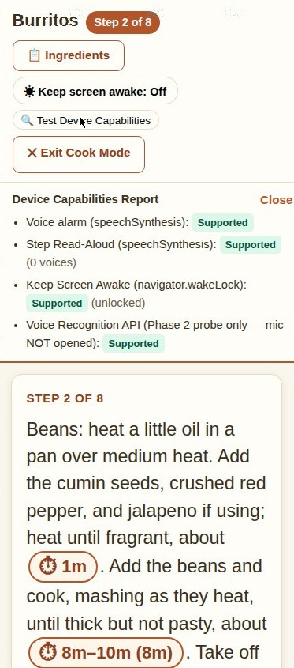

---

## 5. Meal Planner

Tap **Meal Planner** in the top navigation bar to open the weekly planner (`#/planner`).

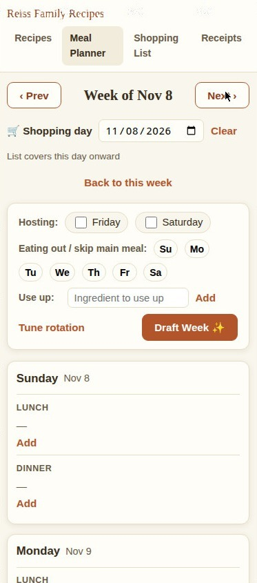

### Navigating Between Weeks and Setting the Shopping Day
1. **Week Navigation:** Weeks run from **Sunday** through **Saturday**.
   - Tap **‹ Prev** or **Next ›** at the top to view past or upcoming weeks.
   - Whenever you are viewing a past or future week, a **Back to this week** button appears below the header—tap it to return to the current week.
2. **Shopping Day (`🛒 Shopping day`):**
   - Pick a date in the **🛒 Shopping day** field if you are shopping mid-week and only want the Shopping List to include meals from that date onward.
   - Tap **Clear** next to the date to include the entire week again.

### Drafting a Week Automatically (`Draft Week ✨`)
Above the day cards is the **Draft Week** bar, which lets you tell the planner about your week before it fills in meals:
1. **Hosting (`Friday` / `Saturday`):**
   - Check **Friday**, **Saturday**, or both if you are hosting guests for Shabbat.
   - When checked, the planner favors Shabbat recipes that naturally serve a crowd (6+ or 8+ servings) without artificially multiplying recipe scales.
2. **Eating out / skip main meal (`Su` `Mo` `Tu` `We` `Th` `Fr` `Sa`):**
   - Tap any day chip to highlight it if you plan to eat out or skip cooking that day's main meal (dinner on Sunday–Wednesday and Friday; Shabbat lunch on Saturday).
   - When you tap **Draft Week ✨**, highlighted days are automatically marked `Skipped — Eat out` (unless you already placed a locked or manual dish there). Un-highlighting a chip and re-drafting clears the automatic `Eat out` mark.
   - **Note:** Thursday (`Th`) is always kept as standing pizza night.
3. **Use up (`Ingredient to use up`):**
   - If you have ingredients in the fridge or pantry you want to use this week (up to 5 items), type an ingredient into **Ingredient to use up** and tap **Add** (or press `Enter`).
   - Each added ingredient appears as a small chip with an **✕** button to remove it. Recipes using those ingredients get a priority boost when drafting.
4. Tap **Draft Week ✨**:
   - The planner fills all unlocked, non-manual meal slots for the week and saves automatically:
     - **Thursday Dinner:** Always fills with **Pizza** (`🔒` locked, `Standing — Thursday pizza night`) if the slot is empty.
     - **Shabbat Mains (Friday Dinner & Saturday Lunch):** Picks meat or pareve Shabbat-appropriate mains. If both Friday dinner and Saturday lunch picks take 90 minutes or longer, the heavier dish is automatically marked `Cook Thursday` (`(cook YYYY-MM-DD)`) so Friday prep stays manageable.
     - **Shabbat-Leftovers Night (Monday, or Tuesday fallback):** If the previous week's Shabbat mains have at least 2 leftover servings available, Monday dinner (or Tuesday if Monday is unavailable) is filled with those leftovers.
     - **Sunday–Wednesday Dinners:** Balances the week across ground beef, pasta, chicken, and fish/vegetarian mains—allowing slightly longer dishes on Sunday (`sunday` effort tier) and quicker dishes Monday–Wednesday (`weeknight` effort tier), avoiding back-to-back repeats, and prioritizing `Favorite` recipes and dishes you haven't cooked recently.
     - **Monday–Friday Lunches (Leftover Coverage):** Automatically assigns leftover servings from Shabbat and from earlier dinners in the week to cover Monday–Friday lunches (2 servings needed Monday–Thursday; 1 serving needed on Friday; leftovers stay usable for up to 7 days and never repeat 3 days in a row).

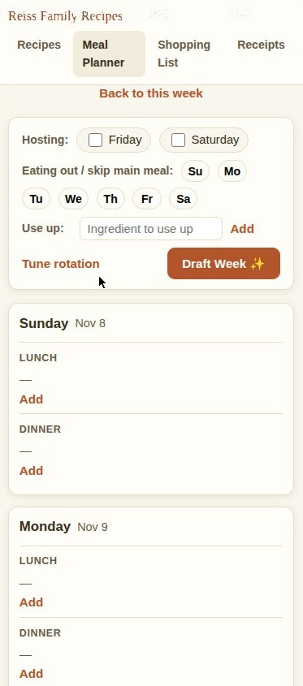

### Planning Vacation Weeks or Skipping Days
1. **Quick method (using day chips):** Tap the **Eating out / skip main meal** chips (`Su`, `Mo`, `Tu`, `We`, `Fr`, `Sa`) for the days you will be away, then tap **Draft Week ✨**.
2. **Manual method (protected from re-drafts):** On any meal slot, tap **Add** (or **Edit**), check the **Skipped** box, type an optional note (such as `"Vacation"`), and tap **Save**. Manual skips with custom notes are never changed by **Draft Week ✨**.

### Swapping, Locking, and Reading Warnings on Drafted Meals
1. **Why a dish was picked:** Every dish placed by **Draft Week ✨** shows a short explanation underneath (for example, `Pasta night · Favorite · Leftovers cover a lunch` or `Leftovers from Shabbat`).
2. **↻ Swap:** On any drafted, unlocked non-leftover dish, tap **↻ Swap** to replace it with the next best dish of the same kind (cycling through the top 5 matches without re-drafting the rest of your week). Swapping a dinner automatically updates your week's leftover lunch coverage.
3. **🔒 Lock / 🔓 Unlock:** Tap **🔒 Lock** on a drafted dish you want to keep; it gains a `🔒` icon and **Draft Week ✨** will leave it untouched if you re-draft the week. Tap **🔓 Unlock** to allow it to be re-drafted again.
4. **Needs a side badge:** If a planned main dish is flagged as needing a side dish and is the only dish in that slot, a yellow **Needs a side** badge appears next to it. Tap **+ Add dish** on that slot to add a side dish, and the badge disappears automatically.
5. **Lunch Coverage Warnings:** If Monday–Friday lunches cannot be fully covered by leftovers from your planned dinners, a yellow banner appears above the week (`⚠ Tuesday lunch isn’t covered by leftovers` or `⚠ Wednesday lunch only has ~1 leftover serving (needs 2)`), along with a **Not covered** or **Only 1 of 2 servings** badge on that lunch slot. Tap **✕** on the banner to dismiss the warning.

[SCREENSHOT: Shot 15 — Planner day card showing a drafted dinner with its reason line, Edit / ↻ Swap / 🔒 Lock buttons, a "Needs a side" badge, and a lunch coverage warning banner above]

### Adding, Editing, or Clearing Meals Manually
1. On any day's **Lunch** or **Dinner** slot:
   - Tap **Add** (or **+ Add dish** if the slot already has a dish—you can plan multiple dishes, such as a main and a side, in a single meal).
   - Tap **Edit** next to an existing dish to change it.
   - Tap **Clear** to clear all dishes and notes from that meal slot.
2. When the **Slot Editor** opens:
   - **Dish box (`Type a recipe or your own dish…`):** Start typing to see a dropdown of matching recipes from the collection (each showing when you last cooked it, such as `Last made 3 wks ago`). Tap a recipe from the list, **or** simply type any free-text dish name (such as `"Leftover soup"` or `"Out for dinner"`) and leave it as-is.
   - **Leftovers / already made (excludes from shopping list):** Check this if you are eating something already cooked so its ingredients aren't added to the Shopping List.
   - **Prepare in advance:** Check this to pick an earlier **Cook date** (for example, cooking a Friday dish on Thursday).
   - **Scale (`0.5×`, `1×`, `1.5×`, `2×`, `3×`):** Multiplies this dish's ingredient quantities on the Shopping List and adjusts how many leftover servings the planner expects from it.
   - **Version:** If the recipe has multiple versions (such as Beef vs. Chicken), tap the version pill you plan to cook so the Shopping List buys the right ingredients.
   - **Locked — Draft Week won’t change this dish:** Checked by default for manual edits so **Draft Week ✨** won't overwrite your choice.
   - **Skipped** and **Note (optional):** Mark the meal slot as skipped or attach a short note.
3. Tap **Save** (or **Cancel** to close without saving).

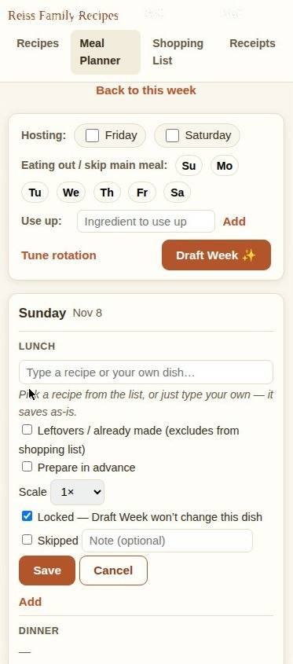

### Post-Meal Feedback and Tuning the Rotation (`#/planner/tune`)
1. **Post-Meal Feedback Row (on past dinners):**
   - Once a planned dinner date has passed, a compact feedback line appears underneath the cooked recipe on the Meal Planner:
     - **How was it?** Tap **Favorite**, **Fine**, or **Skip** to update the family rating for that recipe.
     - **Left:** Tap **None** (0 servings), **A little** (~1 serving), **A lot** (~2 servings), or **Most** (~3+ servings) to log how much food was left after dinner—or tap **✕** to dismiss the prompt without logging leftovers.
   - Logging **Left:** teaches the planner how many leftover lunches that specific recipe actually yields in your kitchen!

[SCREENSHOT: Shot 17 — Past dinner slot in the Meal Planner showing the inline feedback row: "How was it? [Favorite] [Fine] [Skip] · Left: [None] [A little] [A lot] [Most] [✕]"]

2. **Tune the Rotation (`#/planner/tune`):**
   - In the Draft Week bar on the Meal Planner, tap **Tune rotation**.
   - Every recipe in the collection is listed under its category (`Ground beef`, `Beef & roasts`, `Chicken`, `Fish`, `Pasta`, `Veg & vegetarian`, `Other`).
   - Next to any recipe, tap a pill to override the planner's automatic guess (or tap **Auto** to go back to the automatic setting):
     - **Effort:** `Auto` | `Weeknight` (Mon–Wed) | `Sunday` (up to 75–90 min) | `Shabbat` (Fri/Sat) | `Special` (special occasions only—never auto-drafted)
     - **Rating:** `Auto` | `Favorite` | `Fine` | `Skip` (`Skip` excludes the recipe from auto-drafting)
     - **Side:** Tap **Needs a side** to toggle whether this dish displays a `Needs a side` reminder badge when planned alone.
   - Tap **← Back to planner** at the top left when finished.

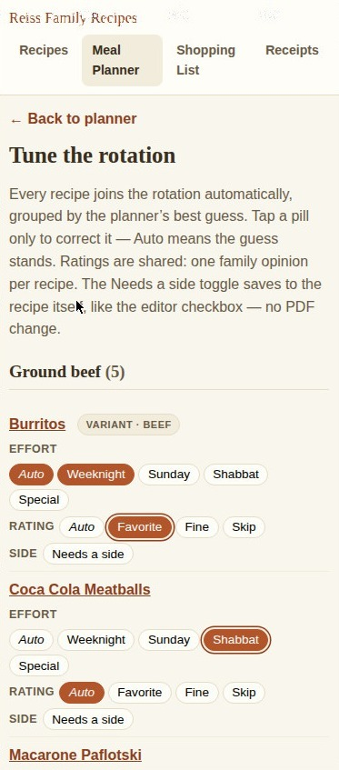

---

## 6. Shopping List

Tap **Shopping List** in the top navigation bar to open this week's grocery list (`#/shopping`).

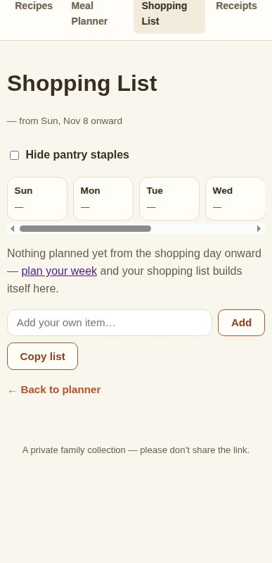

### How the Shopping List Builds Itself
1. The Shopping List automatically combines all ingredients from the current week's planned recipes (excluding dishes marked **Leftovers** and meals before your chosen **Shopping day**).
   - If a dish was scaled in the planner (such as `2×`), its ingredient amounts are multiplied automatically.
   - If a recipe has versions (such as Beef vs. Chicken), only the shared ingredients and the chosen version's ingredients are included.
   - Measurements in teaspoons, tablespoons, and cups of the same ingredient are combined into a single line, and size words (like `"large"` in `"1 large egg"`) are merged so you don't see separate lines for `"eggs"` and `"large eggs"`.
2. **Department Sections:** Items are grouped in store-aisle order under department headers (such as Produce, Meat & Poultry, Dairy, Bakery, Pantry, etc.), with a count badge on the right of each department header.

[SCREENSHOT: Shot 20 — Shopping List (#/shopping) with generic sample items grouped under store department headers, showing the ○ circle buttons, Optional (N) collapsed section, Pantry staples (N) collapsed section, Already have (N) collapsed section, Add your own item box, and Copy list button]

### Checking Off Items (`To buy` ↔ `Already have`)
1. As you check your kitchen before shopping—or as you put items into your cart at the store—tap the empty circle **○** to the left of any item under **To buy**.
2. The item moves immediately into the collapsible **Already have (N)** section at the bottom of the list, marked with a filled circle **●**.
3. Tap **●** next to any item in **Already have** to move it back up to **To buy**.
4. **Smart Quantity Splitting:** Suppose you mark `1 cup honey` as **Already have**, and later add another recipe to your meal plan that calls for 2 more cups of honey (3 cups total). The list keeps `1 cup honey` inside **Already have** and places a separate `2 cups honey` remainder line in **To buy** so you know to pick up the extra 2 cups!
5. **Works Offline & Detects Duplicate Grabs:**
   - Every tap saves right away on your phone—even if cell service drops inside the grocery store—and syncs with the server every 15 seconds.
   - If two people are shopping at the same time on different phones and both tap the same item before their phones sync, a warning appears next to the item in **Already have**: `⚠️ Both grabbed this — check for duplicates`. Tap **dismiss** to clear the warning.

### Managing Optional Ingredients (`Optional (N)`)
1. Recipe ingredients marked *`optional`* never clutter your main **To buy** list automatically; instead, they sit inside the collapsed **Optional (N)** section.
2. Tap **Optional (N)** to expand it. Each optional item has two buttons on the right:
   - Tap **+** to promote the item into **To buy** for this week. (If you change your mind later, tapping its **○** button in **To buy** sends it back to **Optional**.)
   - Tap **✓** to mark that you **Already have** it on hand.

### Hiding Pantry Staples (`Hide pantry staples`)
1. Check **Hide pantry staples** at the top of the Shopping List to tuck everyday kitchen basics (water, salt, black pepper, olive and vegetable oil, standard ground spices, honey, flour, sugar, cornstarch, baking powder, and baking soda) out of **To buy**.
2. Hidden staples move into a collapsed **Pantry staples (N)** section below **To buy**, where you can still expand and check them if you happen to be out of one.
   - **Note:** Your toggle choice is remembered on your device. Any staple you explicitly promoted from **Optional** with **+**, as well as any manual items you typed yourself, always stay visible in **To buy**.

### Adding Manual Items and Copying the List
1. **Add your own item:** Scroll to the **Add your own item…** box near the bottom, type anything you need (such as `"Paper towels"` or `"3 avocados"`), and tap **Add** (or press `Enter`).
   - Manual items sort automatically into their matching store department (or `Unsorted` if unrecognized).
   - Tap **○** / **●** to check or uncheck a manual item, or tap **×** on the right to remove it.
2. **Copy list:** Tap **Copy list** at the bottom to copy your active **To buy** items (organized under `[Department]` headings, followed by `[Optional]` items, and respecting your **Hide pantry staples** setting) to your clipboard (`Shopping list copied`).

---

## 7. Submitting Recipes and the Recent Submissions Log

To add a recipe without typing out every ingredient and step yourself, tap **+ Add a recipe** on the Home page (`#/`) or on the **Recipes** page (`#/recipes`). This opens the unified **Add a recipe** screen (`#/submit`) with **✨ Auto-Import (Link / Photo / Text)** selected by default (you can switch to **✍️ Manual Form (Type Ingredients)** at any time using the toggle at the top of the screen without losing anything you've typed).

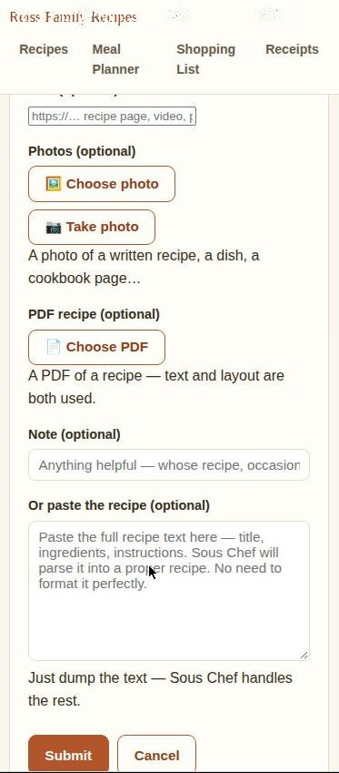

### Submitting a Link, Photo, PDF, or Pasted Text
You can fill in any one of the fields below—or combine them (for example, a recipe link plus a note, or several photos of a handwritten recipe card):
1. **Link (optional):** Paste a web address (`https://…`) for a recipe page, blog post, or video (including YouTube videos).
2. **Photos (optional — up to 6 photos):**
   - Tap **🖼️ Choose photo** to select up to 6 photos from your phone or computer gallery.
   - Or tap **📷 Take photo** to open the built-in camera view directly inside the page (`Capture` / `Cancel`). Using the built-in camera keeps your browser tab open so Android never loses your page.
   - Each attached photo appears as a numbered thumbnail (`1` through `6`) with a red **×** button in its corner to remove it if needed.
   - **Multi-page recipes & photo batches:**
     - If a recipe spans multiple pages or both sides of a card, attach all the photos in one submission—the intake checker reads all pages together and uses the clearest photo of the finished food as the recipe banner.
     - If you submit a batch of photos containing **multiple separate recipes**, the checker automatically inventories the photos and splits each clear recipe into its own separate submission entry!

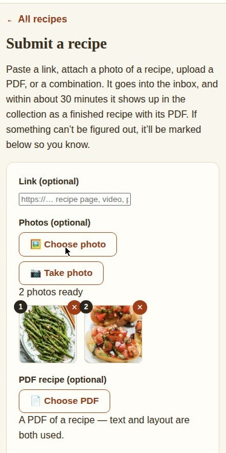

3. **PDF recipe (optional):** Tap **📄 Choose PDF** to attach a PDF file of a recipe.
4. **Note (optional):** Add any helpful context—such as whose recipe it is, what occasion it's for, or which dish to pull from a multi-recipe page.
5. **Or paste the recipe (optional):** Paste raw, unformatted recipe text (title, ingredients, steps, or a message copied from a chat) straight into the text box.
6. **Automatic Draft Protection:** As soon as you type or attach photos, your draft is saved in your browser's local storage so it is restored automatically if your tab reloads. (Tap **Cancel** if you want to discard your draft and return home.)
7. Tap **Submit**. You will see `Submitted — it should appear in the collection within about 30 minutes.`

### Understanding the Recent Submissions Log
Scroll down to **Recent submissions** on the `#/submit` page to check the status of submitted recipes and edits. By default, the latest 10 entries are shown; tap **Show all (N)** to see the entire history (or **Show recent only** to collapse it). The list refreshes automatically every 60 seconds while open.

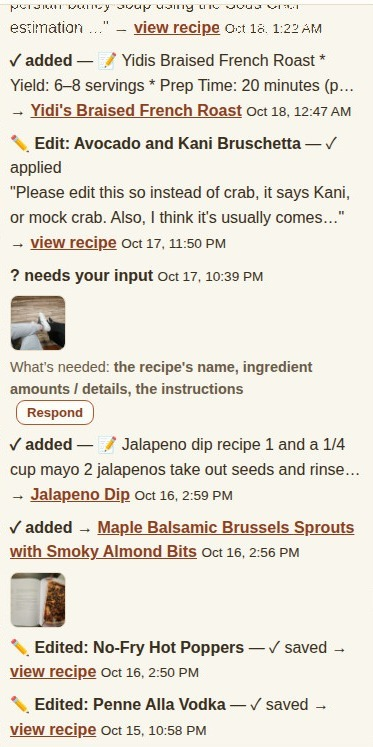

Each entry in the log displays a status badge:
- **… in the inbox** — Submitted and waiting for the next 30-minute background checker run.
- **… working on it** — The checker is currently extracting the recipe and building its PDF.
- **✓ added** — Complete! Tap the **→ Recipe Title** link on the row to open the finished recipe.
- **⧉ duplicate — skipped** — The checker found that this recipe is already in the collection (`(duplicate of <Recipe Title>)`) and skipped creating a second copy.
- **? needs your input** — Something important was missing or unreadable (for example, a cut-off photo or a page with several recipes where it wasn't clear which one you wanted). Instead of guessing, the checker pauses and shows:
  - A **What’s needed:** line in plain words (such as `the recipe's name`, `ingredient amounts / details`, `the instructions`, `how much it makes (servings)`, `a clearer photo`, or `which recipe(s) to add`).
  - A **Respond** button right on the log row.
- **⚠ needs attention** — An error occurred while fetching or processing the submission, shown with a red explanation and a **Retry** button.
- **✏️ Edit / ✏️ Edited / 🗑️ Deleted** — AI edit requests, manual recipe saves, and recipe deletions also appear in this log so you have a complete timeline of changes to the collection.

### Viewing Submission Photos, Responding to Questions, and Retrying
1. **Viewing Submitted Photos (Lightbox):**
   - Any log row that included photos shows small clickable photo thumbnails underneath.
   - Tap any thumbnail to open the full-screen photo viewer. Use the **‹** and **›** buttons (or keyboard `Left` / `Right` arrows) to flip through multiple photos, and tap **✕** (or press `Escape`) to close.
2. **Responding to a `? needs your input` Entry:**
   - Tap **Respond** on the log row to open the inline answer box.
   - Read the prompt at the top of the box, type the missing information into **Type the missing details…**, and/or tap **📷 Attach photo** to attach clearer or missing page photos.
   - Tap **Send answer** (or **Cancel**). If your browser hasn't asked for your name before, a one-time prompt asks `Your name (for change history):`.
   - Your answer and any new photos are attached to the submission, and its status returns to **… in the inbox** so the checker picks it up on its next run (within about 30 minutes).

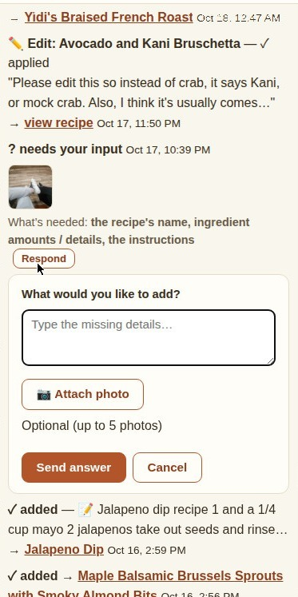

3. **Retrying a `⚠ needs attention` Entry:**
   - Tap **Retry** on the failed row to clear the error and place the submission back into **… in the inbox** for the next checker run.

---

## 8. Adding, Editing, and Deleting Recipes (Plus Change History)

You can create a new recipe manually by tapping **+ Add a recipe** on the Home page (`#/`) or the Recipes page (`#/recipes`) and switching the top toggle to **✍️ Manual Form (Type Ingredients)** (or visiting `#/add` directly, which opens the unified screen with Manual Form preselected), or edit any existing recipe by tapping **Edit** at the bottom of its recipe page (`#/edit/<id>`).

### Option 1: Describe Changes in Plain Words (AI Edit)
At the top of the **Edit recipe** page (`#/edit/<id>`) is a shaded box labeled **🤖 Describe changes in plain words**:
1. Type what you want changed in everyday language (for example: *"Halve the sugar, add 1 tsp vanilla extract, and mark it good for leftovers"*).
2. Tap **Submit for AI edit**.
3. Your request goes into the inbox queue (and appears in **Recent submissions** as `✏️ Edit: <Recipe Title>`). Within about 30 minutes, the background checker updates the recipe and regenerates its printable PDF.

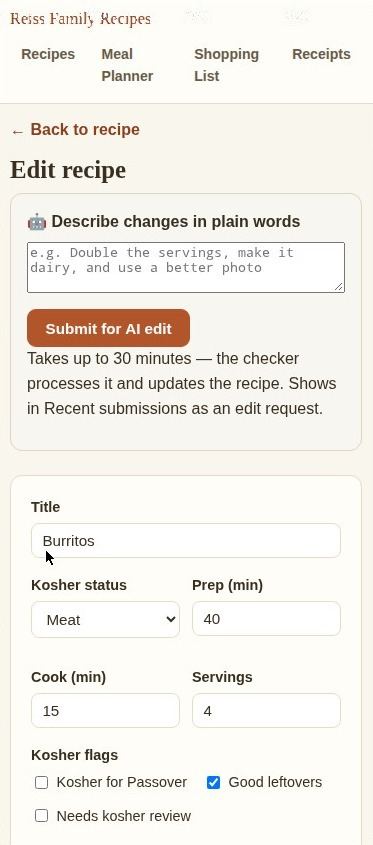) showing the &quot;🤖 Describe changes in plain words&quot; AI edit box and the top fields of the manual recipe form (Title, Kosher status, Prep, Cook, Servings, Kosher flags, Planning, Categories)" width="373">

### Option 2: Using the Manual Recipe Form
Below the AI edit box (or inside the **✍️ Manual Form** tab when creating a new recipe at `#/submit` or `#/add`) is the full manual form:
1. **Basic Info & Flags:**
   - **Title:** The recipe's display name.
   - **Kosher status:** `Meat`, `Dairy`, or `Pareve`.
   - **Prep (min)**, **Cook (min)**, and **Servings** (a number like `6` or a range like `6-8`).
   - **Kosher flags:** Check **Kosher for Passover**, **Good leftovers**, or **Needs kosher review** (checking **Needs kosher review** opens a **Kosher review notes** box where you can write what needs checking).
   - **Planning:** Check **Needs a side** if this main dish should show a reminder badge in the Meal Planner when planned without a side dish.
   - **Categories** and **Tags (comma-separated)**.
2. **Photos & PDFs:**
   - **Banner image path:** Leave blank for an automatic warm gradient title card, or keep the existing image path.
   - **Photo — pick from your phone or computer:** Tap **Choose File** to upload a photo from your device; when you save, it automatically resizes and becomes the recipe's banner photo.
   - **PDF file path** and **Leftovers note**.
3. **Versions (optional):**
   - If the dish has multiple named versions (such as `Chicken` and `Beef`), tap **+ Add version**, type each version's name, and select which one is **Default**.
   - Tap **✕** next to a version to remove it (any ingredients tagged to that version become shared ingredients).
4. **Ingredients:**
   - Ingredients are grouped into sections (for example, `Dough` and `Filling`, or a single unnamed section). Tap **+ Add section** to add a section or **Remove** to delete one.
   - Within a section, each row has columns for **Qty**, **Unit**, **Ingredient**, **Prep**, **Opt?** (check if optional), **Version** (`Shared` across all versions, or tied to one specific version), and **✕** (remove row).
   - **Automatic comma split:** If you type a comma inside the **Ingredient** box while **Prep** is empty—such as `"red onion, finely chopped"`—it automatically splits `"red onion"` into **Ingredient** and `"finely chopped"` into **Prep** so your Shopping List stays clean!
   - Tap **+ Add ingredient** to add another row.

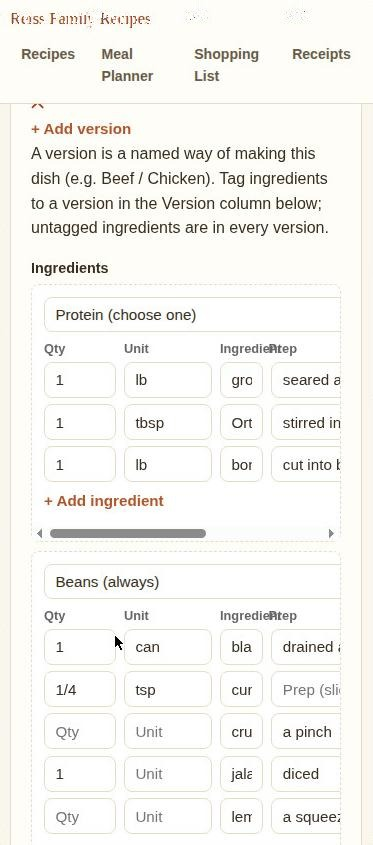

5. **Instructions:**
   - Tap **+ Add step** to add a numbered instruction step.
   - Use the **↑** and **↓** buttons to move a step earlier or later, or **✕** to delete a step.
6. **Pairings, Notes, and Source:**
   - Tap **+ Add pairing**, start typing in **Type to search recipes…** to pick a companion recipe from the dropdown, and add an optional pairing note.
   - Fill in **Notes** or **Source** if desired.
7. **Saving & Change Attribution:**
   - Optionally fill in **Why did you change this?** right above the Save button (for example, `"Fixed baking time after making it"`).
   - Tap **Save recipe**. (The first time you save on a device, a browser prompt asks `Your name (for change history):` and remembers your name for future saves.)
   - **Instant Card Update & Background PDF Rebuild:** Saving immediately updates the recipe AND rebuilds its summary card on the browse grid (so cooking times, kosher badges, and versions never go stale), logs the edit to **Recent submissions**, and flags the recipe's printable PDF to be regenerated on the next checker run.
   - **Conflict Protection:** If someone else edited and saved the same recipe while you had the edit form open, the site protects their work and alerts you: `This recipe was changed by someone else since you opened it. Reload the page to see the latest, then re-apply your changes.`

### Viewing a Recipe's Change History
1. At the bottom of the **Edit recipe** page (`#/edit/<id>`), tap **Change history (N)** to expand the collapsible history log.
2. Every recorded change is listed newest-first, showing:
   - What kind of change it was (`intake` when created, `edit` for edits, `estimate`, or `re-press` when the PDF was regenerated), who made it, and the date/time.
   - Any reasoning note entered when saving (in quotes).
   - A bulleted list of the exact fields that changed (`field: old value → new value`).

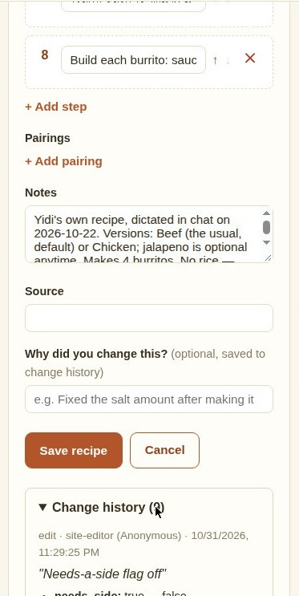

### Deleting a Recipe
1. Open the recipe you want to remove and scroll to the bottom danger zone.
2. Tap **Delete recipe** to open the confirmation page (`#/delete/<id>`).
3. Review the recipe title on the confirmation screen:
   - Tap **Yes, delete it** to permanently remove the recipe, its PDF, and its card from the collection (and record the deletion in **Recent submissions**).
   - Tap **Cancel** (or **← Back to recipe**) to keep the recipe.

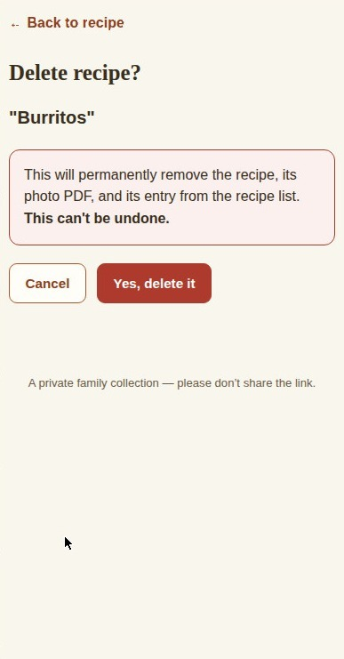) showing the warning message along with Cancel and &quot;Yes, delete it&quot; buttons" width="373">

---

## 9. Receipts and Price History Lookup

Tap **Receipts** in the top navigation bar to open the grocery receipts archive and price lookup (`#/receipts`).

### Signing In with Google (Receipts Only)
While recipes, the meal planner, and the shopping list never require a login, the **Receipts** area is private and protected by **Sign in with Google**.
1. When you open `#/receipts` for the first time on a device, you will see the **Receipts** lock card with a **Sign in with Google** button.
2. Tap **Sign in with Google** and choose one of the three authorized family Google accounts.
3. Once verified, you stay signed in on that device for **90 days** (unless you tap **Sign out**).

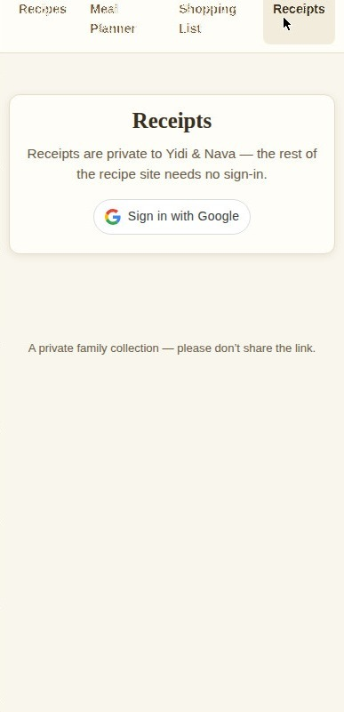

### Scanning or Uploading a Receipt (Single or Multi-Photo)
1. Once signed in, you will see the **Receipts** dashboard (`#/receipts`).

[SCREENSHOT: Shot 30 — Receipts dashboard (#/receipts when signed in) showing the top action buttons (+ Scan / Upload Receipt, Choose Photo(s), Sign out), the Price History Lookup card, and the Recent Receipts section]

2. To add a receipt:
   - Tap **+ Scan / Upload Receipt** to take a photo with your phone's camera.
   - Or tap **Choose Photo(s)** to pick one or more photos from your gallery.
3. **Automatic Photo Preparation:** Your browser automatically rotates and compresses each photo so the text stays sharp for reading while fitting comfortably under the 1.8 MB upload limit.
4. **Staging Tray (for Single or Long Multi-Part Receipts):**
   - Your selected photo(s) appear in the **Staged Receipt** tray (`Staged Receipt (X photos of 6 max)`).
   - For a long paper receipt, take up to **6 overlapping photos in order from top to bottom** by tapping **+ Add Another Photo** (camera) or **+ From Gallery**.
   - You can remove any staged photo by tapping **×** on its thumbnail, or start over by tapping **Clear**.
5. Tap **Upload Receipt (X photo(s))** to send the receipt:
   - If you are offline or lose reception mid-upload, the prepared photos are saved safely on your device and a retry banner appears at the top (`Unuploaded receipt photo saved offline on this device.`) with **Retry Upload** and **Discard** buttons.

[SCREENSHOT: Shot 31 — Staged Receipt tray on #/receipts showing staged photo thumbnails ("Photo 1", "Photo 2") with KB sizes, remove (×) buttons, and the "Upload Receipt", "+ Add Another Photo", "+ From Gallery", and "Clear" buttons]

### Waiting for Extraction and Handling Unreadable Photos
1. Right after upload, you will see `Uploaded — it should appear below as a Review Card within about 30 minutes.`
   - In **Recent Receipts**, the new receipt appears with a **Pending Extraction** badge (`Receipt (extracting…)`).
   - While you keep the page open right after uploading, it checks automatically every 15 seconds for the first couple of minutes and opens the Review Card if ready; otherwise, check back after the next 30-minute background checker run.
2. **If a Receipt Photo is Unreadable:**
   - If the checker cannot read the photo (for example, if it is too blurry or cut off), the receipt is marked with a red **Unreadable** badge and a plain-words reason note.
   - Tap the receipt to open it: a red **Unreadable Receipt** banner at the top explains why it couldn't be read and gives you buttons to **Retake / Replace Photo**, **+ Add Photo**, or **Delete Receipt**.

[SCREENSHOT: Shot 32 — Unreadable Receipt banner at the top of a receipt detail page showing the reason text and the "Retake / Replace Photo", "+ Add Photo", and "Delete Receipt" buttons]

### Reviewing and Confirming a Receipt (`#/receipts/<id>`)
When extraction finishes, the receipt shows a **Needs Review** badge in **Recent Receipts**. Tap the receipt card to open its **Review Card** (`#/receipts/<id>`).

[SCREENSHOT: Shot 33 — Receipt Review Card (#/receipts/<id>) showing the Receipt Photo pane on the left, the Store / Date / Ticket # / Subtotal / Total / Total Saved fields on the right, the live checksum bar, the sticky-header line items table with a highlighted flagged row and its plain-words review reason, and the "Save Verified Receipt" button]

1. **Left Pane — Receipt Photo(s):**
   - Displays your uploaded receipt photo (or stacked `Part 1 of N`, `Part 2 of N` photos in order for multi-photo receipts).
   - **Tap any photo to zoom** in and out full-screen so you can compare a register line against the paper receipt.
   - If a long receipt was missing a bottom section, tap **+ Add Photo (Part N+1)** (up to 6 parts total) to append another photo and re-queue extraction.
   - Before a receipt is verified, you can also tap **Delete Receipt** in the top-right corner to remove it.
2. **Right Pane — Store Header & Live Penny Checksum:**
   - Check the top fields: **Store**, **Date (YYYY-MM-DD)**, **Ticket #**, **Subtotal ($)**, **Total ($)**, and **Total Saved ($)**.
   - Directly below those fields is the **Checksum Bar**:
     > `Items sum to $X.XX of $Y.YY total`
   - To protect your price history from typos or misread digits, the **Save Verified Receipt** button stays disabled until the `Paid $` column across all line items adds up to the **exact penny** of `Total ($)` (turning the checksum bar green).
3. **Scrollable Line Items Table with Sticky Header and Flagged Reasons:**
   - Scroll through the line items table—the column headers (**Register Line / Dept**, **Brand**, **Product**, **Pack**, **Qty/Wt**, **Unit**, **Reg $**, **Sale $**, **Paid $**, **Shopping groupKey**) stay **pinned (sticky)** at the top of the box so you always know which column you are editing.
   - **Flagged Lines & Plain-Words Reasons:** If the extractor wasn't 100% sure about a line (for example, a smudged price or a weighed produce line where quantity × unit price didn't match the paid price), that row is highlighted and displays a short plain-words reason directly beneath the raw register text (such as `"Quantity × price doesn't match the paid price."`).
   - Edit any field in the table—as you type in `Paid $` or `Total ($)`, the checksum bar recalculates live on every keystroke.
   - The **Shopping groupKey** column links the receipt item to the canonical ingredient name used by your Shopping List (such as `olive oil` or `feta cheese`).
4. **Confirming (`Save Verified Receipt`):**
   - Once the checksum bar is green (`Items sum to $X.XX of $X.XX total`), tap **Save Verified Receipt**.
   - The receipt's status changes to **Verified**, locking it from future background overwrites, and the system automatically remembers your **Brand**, **Pack**, and **Shopping groupKey** for each raw register line (`sku_aliases`) so the next receipt you scan from that store fills them in automatically!

### Looking Up Past Prices (`Price History Lookup`)
1. On the main **Receipts** dashboard (`#/receipts`), find the **Price History Lookup** box.
2. Type a product name, brand, or ingredient group key (such as `feta` or `olive oil`) and tap **Search** (or press `Enter`).
3. A results table lists up to 50 matching purchases newest-first, showing:
   - **Date** (tap the date link to open that receipt's Review Card)
   - **Store**
   - **Brand / Item**
   - **Pack / Qty**
   - **Reg / Sale** price
   - **Paid** price
   - **Group Key**

[SCREENSHOT: Shot 34 — Price History Lookup card on #/receipts showing the search input, Search button, and the results table columns (Date, Store, Brand / Item, Pack / Qty, Reg / Sale, Paid, Group Key)]

### Signing Out of Receipts
To lock the Receipts area on your current browser, tap **Sign out** in the top-right corner of the `#/receipts` dashboard. This clears your session token and returns you to the Google Sign-In screen.

---

## 10. How the System Works (Architecture Overview)

This section explains how the pieces of **Reiss Family Recipes** fit together behind the scenes in plain language.

### 1. The Public Static Site (GitHub Pages)
- **What is a static site?** The website itself is a collection of plain files (`index.html`, `app.js`, and `styles.css`) hosted on **GitHub Pages** (`https://yidireiss.github.io/recipes/`) from the `main` branch of the `YidiReiss/recipes` repository. There is no complex framework or build step—your browser runs those files directly.
- **Fast Loading on Startup:** When you open the site, your browser does *not* download all 100+ full recipes at once. Instead, it fetches two small summary files in parallel:
  1. `data/recipes/meta.json` — A lightweight list of recipe "cards" containing just what is needed to browse, search, filter, and sort the grid (title, banner path, kosher badges, prep/cook times, servings, categories, tags, variants, `needs_side`, `ingredients_text`, and `search_text`).
  2. `data/shopping-sections.json` — The grocery store department list used to group the Shopping List.
  It also fetches the current meal plan (`data/meal-plan.json`). Full recipe files (`data/recipes/<id>.json`) are downloaded on demand only when you open a recipe or build the Shopping List, and are cached in memory for the rest of your visit.

### 2. The Private Write Bridge (Cloudflare Worker — `worker.js`)
- **Why a bridge is needed:** GitHub Pages can *serve* files to anyone, but saving changes back to the GitHub repository requires a secret GitHub security token (`GITHUB_TOKEN`). Putting that token inside browser code would expose it publicly.
- **How the bridge works:** Whenever you save a recipe, update the meal plan, check off a shopping item, or submit a recipe, your browser sends the change to a private **Cloudflare Worker** (`https://recipe-bridge.leibreiss.workers.dev`). The Worker holds the GitHub token safely on Cloudflare's servers, verifies that the file path is on its strict allowlist (`data/recipes/`, `data/meal-plan.json`, `data/inbox/`, `assets/images/`, `pdfs/`), and commits the change to GitHub on your behalf.
- **Bypassing Rebuild Delays (`GET /read`):** After a file is committed to GitHub, GitHub Pages takes about 1 to 2 minutes to republish its static web cache. So that two devices never see stale meal plans, shopping checkmarks, or inbox logs during that window, the site reads live files through the Worker's `/read` endpoint, which fetches the up-to-the-second file directly from GitHub's API.
- **Single-Writer Recipe Cards (`POST /save-recipe`):** Every recipe edit goes through the Worker's `/save-recipe` endpoint. In a single server-side flow, the Worker:
  1. Checks the file's version fingerprint (**SHA**—a unique hash identifying the exact version of the file when you opened it) and rejects stale saves with a `409 Conflict` if someone else saved in the meantime.
  2. Computes a field-by-field diff and appends an entry to the recipe's `history` array.
  3. Automatically appends a `direct-edit` summary to `data/inbox/index.json` so every edit shows up in **Recent submissions** (unless `skip_log: true` was passed for quiet planner toggles like `Needs a side`).
  4. **Rebuilds and upserts the recipe's card in `data/recipes/meta.json`** as the **single writer**—ensuring that edited cooking times, kosher flags, ingredients search text, and versions on the browse grid never drift out of sync with the recipe file.

### 3. Meal Plan and Offline-First Shopping Sync (`data/meal-plan.json`)
- All weekly meal plans, shopping checkmarks, manual shopping items, family recipe ratings (`recipePrefs`), leftover yield history (`yieldLog`), and draft snapshots (`draftSnapshots`, used to compare what `Draft Week ✨` proposed against what the family actually ate) live in `data/meal-plan.json`.
- **One Serialized Writer (`saveMealPlan`):** Every change to `data/meal-plan.json` is queued one at a time in your browser. Before writing, it reads the freshest server copy via the Worker's `/read` endpoint and merges it with your local state:
  - For planned meal days, the fresh server copy is the base, with your latest edit applied on top.
  - For shopping list actions (`haveGenerated` checkmarks, `manualItems`, `optionalPromoted`, and `conflictAcked`), both devices' changes merge using **timestamps and tombstones** (a "tombstone" is a deletion or uncheck record stamped with the time it happened, so an older copy on another phone can never accidentally bring back an item you just unchecked or deleted).

### 4. The Intake Checker, Sous Chef, and Recipe Press
- **Intake Checker (`recipe-intake-check`):** A scheduled background task (a **cron job**) that runs every **30 minutes** (Eastern Time), automatically pausing during Shabbat and Yom Tov.
- Each time it runs, it checks `data/inbox/index.json` for `pending` submissions and AI edit requests:
  - **Sous Chef (Recipe Compiler):** Reads submitted links, pasted text, PDFs, or up to 6 photos; inventories multi-photo batches to auto-split separate recipes or combine multi-page recipes; splits ingredient purchase names from cooking prep notes; normalizes measurement units; checks for duplicates; and flags any non-kosher ingredients with `needs_kosher_review` instead of silently altering them. If information is missing or ambiguous, it sets the entry to `needs_input` so you can reply via the **Respond** button.
  - **Recipe Press (`make_pdf.py`):** Generates a styled, printable PDF (`pdfs/<id>.pdf`) for every new recipe—and regenerates the PDF whenever an edited recipe has `pdf_stale: true`—complete with kosher color themes (red for meat, blue for dairy, green for pareve), hero photos, and leftover badges.
  - **Self-Healing Index Check:** On every run, the checker also compares `data/recipes/index.json` and `data/recipes/meta.json` and repairs any missing or orphaned card automatically.

### 5. Private Receipts and Cloudflare D1 (`receipts.js`)
- **Complete Separation from the Public Repo:** Unlike recipes, grocery receipts are **never** stored in the public GitHub repository. Instead, all `/receipts/*` requests on the Worker are handled by `receipts.js` and stored in a private **Cloudflare D1** relational SQL database (`receipts`, `receipt_files`, `receipt_items`, and `sku_aliases`).
- **Authentication:** When you sign in with Google at `#/receipts`, the Worker verifies your Google ID token against Google's public keys and checks that your email is one of the 3 allowlisted family addresses. It then signs a **90-day HMAC-SHA256 session token** stored in your browser's `localStorage` (`reiss_receipt_token`). Every receipt upload, view, search, confirmation, or deletion requires this token.
- **Privacy Guards & Human Verification:**
  - When the background checker extracts a receipt via `POST /receipts/<id>/extract`, the Worker enforces strict privacy filters that reject any payload or status note containing payment card numbers, phone numbers, customer names, or street addresses.
  - The background extractor can only set a receipt's status to `needs_review` or `unreadable`—**never** `verified`. Only a signed-in family member clicking **Save Verified Receipt** (`POST /receipts/<id>/confirm`) after the line items pass the penny checksum can mark a receipt `verified` and update the store `sku_aliases` table.

---

## 11. Screenshot Shot List

Every placeholder in this guide corresponds to its numbered entry below. All screenshots in the follow-up capture pass must use **empty states or generic UI chrome only** (no personal meal plans, no real shopping list items, no real receipt data or prices, and no names, emails, or addresses).

1. **Shot 1** — Home landing page (`#/`) showing the top navigation bar (`Reiss Family Recipes`, `Recipes`, `Meal Planner`, `Shopping List`, `Receipts`), the three summary cards, and an empty `This week` strip.
2. **Shot 2** — Recipes browse page (`#/recipes`) showing the `"What are we cooking?"` search bar, the `Browse recipes` category tiles, and the recipe card grid.
3. **Shot 3** — Search box on `#/recipes` with a query typed and the instant suggestions dropdown open below it showing matching recipe titles and total times.
4. **Shot 4** — Recipe grid on `#/recipes` with an active search query showing the three labeled result sections: `"Titles matching '…'"`, `"With '…' as an ingredient"`, and `"More matches"`.
5. **Shot 5** — Filter and sort bar expanded on `#/recipes` showing the `Kosher`, `Category`, `Tag`, `Max time`, and `Sort` dropdowns, the `Kosher for Passover` and `Good leftovers` checkboxes, and the `Clear filters` button.
6. **Shot 6** — Recipe detail page (`#/recipe/<id>`) showing the banner, title, kosher badge, `Family rating` buttons, `Cook Mode` bar, `Prep`/`Cook`/`Total`/`Serves` summary strip, and `Ingredients` section.
7. **Shot 7** — `Ingredients` section on a recipe detail page with the `Scale` bar set to `2x` and version pills visible above the scaled ingredient list.
8. **Shot 8** — Bottom of a recipe detail page showing the `Leftovers` box, the `Edit` / `View PDF` / `Share` / `Print / PDF` action buttons, and the `Delete recipe` button.
9. **Shot 9** — Full-screen `Cook Mode` overlay showing the top bar (recipe title, `Step 1 of N` pill, `Ingredients` toggle, `Screen awake` pill, `Test Device Capabilities` pill, `Exit Cook Mode` button), the checkable `Ingredients` pane with `Scale` buttons, the large `Step` card with a timer pill, the `Read step` / `Repeat` / `Auto-read` bar, and the `Prev` / `Next Step` buttons.
10. **Shot 10** — `Active Timers` dock pinned at the bottom of the screen showing a running timer card with `Pause`, `+1m`, `+5m`, `+10m`, `Reset`, and `✕` buttons, plus the `"🗣 Voice: On"` toggle in the dock header.
11. **Shot 11** — `Active Timers` dock showing a finished timer in overtime (`"00:00 · Done! +00:08"`) with the large `"✓ Dismiss"` button.
12. **Shot 12** — `Device Capabilities Report` card open inside `Cook Mode` showing `Supported`/`Not supported` status badges and the `Close` button.
13. **Shot 13** — Meal Planner (`#/planner`) showing an empty week with the week navigation bar (`‹ Prev`, `This week`, `Next ›`), the `Shopping day` row, the `Draft Week` chip bar (`Hosting`, `Eating out` day chips, `Use up` input, `Tune rotation` link, `Draft Week ✨` button), and `Sunday`–`Saturday` day cards.
14. **Shot 14** — `Draft Week` chip bar in its default state (no chips added, no days highlighted).
15. **Shot 15** — Planner day card showing a drafted dinner with its reason line, `Edit` / `↻ Swap` / `🔒 Lock` buttons, a `"Needs a side"` badge, and a lunch coverage warning banner above.
16. **Shot 16** — Slot editor open inside a Meal Planner day card showing the recipe combobox, `Leftovers` checkbox, `Prepare in advance` checkbox, `Scale` dropdown, `Locked` checkbox, `Skipped` checkbox, `Note` input, and `Save` / `Cancel` buttons.
17. **Shot 17** — Past dinner slot in the Meal Planner showing the inline feedback row: `"How was it? [Favorite] [Fine] [Skip] · Left: [None] [A little] [A lot] [Most] [✕]"`.
18. **Shot 18** — `Tune the rotation` page (`#/planner/tune`) showing recipe rows with `Effort` pills (`Auto`, `Weeknight`, `Sunday`, `Shabbat`, `Special`), `Rating` pills (`Auto`, `Favorite`, `Fine`, `Skip`), and the `Needs a side` pill.
19. **Shot 19** — Shopping List page (`#/shopping`) showing the `"Hide pantry staples"` checkbox, the `Sun`–`Sat` week strip, and the empty-state prompt when no meals are planned.
20. **Shot 20** — Shopping List (`#/shopping`) with generic sample items grouped under store department headers, showing the `○` circle buttons, `Optional (N)` collapsed section, `Pantry staples (N)` collapsed section, `Already have (N)` collapsed section, `Add your own item` box, and `Copy list` button.
21. **Shot 21** — `Submit a recipe` page (`#/submit`) showing the `Link` input, `Choose photo` / `Take photo` buttons, `Choose PDF` button, `Note` input, `Paste recipe` text box, `Submit` / `Cancel` buttons, and the `Recent submissions` section header (the submit form is taller than one phone frame — the Link input is cut at the top and the form continues below the frame).
22. **Shot 22** — `Submit a recipe` form with numbered photo preview thumbnails (`1`, `2`) and the red `×` remove buttons visible.
23. **Shot 23** — `Recent submissions` log on `#/submit` showing status badges, clickable photo thumbnails, a `"? needs your input"` row with the `"What's needed"` line and `Respond` button, and a `"⚠ needs attention"` row with the `Retry` button.
24. **Shot 24** — Inline `Respond` form open under a `"? needs your input"` submission row, showing the checker's question, the text box, the `"📷 Attach photo"` button, and the `"Send answer"` and `"Cancel"` buttons.
25. **Shot 25** — Top of the `Edit recipe` page (`#/edit/<id>`) showing the `"🤖 Describe changes in plain words"` AI edit box and the top fields of the manual recipe form (`Title`, `Kosher status`, `Prep`, `Cook`, `Servings`, `Kosher flags`, `Planning`, `Categories`).
26. **Shot 26** — Middle of the `Edit recipe` form showing the `Versions` editor, `Ingredients` editor (with `Qty`, `Unit`, `Ingredient`, `Prep`, `Opt?`, `Version` columns), `Instructions` editor (with `↑` / `↓` / `✕` buttons), and `Pairings` picker (the chosen frame shows the Versions tail + Ingredients editor (Protein/Beans sections); the form continues below).
27. **Shot 27** — Bottom of the `Edit recipe` form showing the `"Why did you change this?"` input, `Save recipe` / `Cancel` buttons, and the expanded `"Change history (N)"` panel.
28. **Shot 28** — `Delete recipe` confirmation page (`#/delete/<id>`) showing the warning message along with `Cancel` and `"Yes, delete it"` buttons.
29. **Shot 29** — `Receipts` lock screen (`#/receipts` when signed out) showing the privacy explanation and the `"Sign in with Google"` button (the receipts area was signed out, so this is the lock screen with the generic Sign in button).
30. **Shot 30** — `Receipts` dashboard (`#/receipts` when signed in) showing the top action buttons (`+ Scan / Upload Receipt`, `Choose Photo(s)`, `Sign out`), the `Price History Lookup` card, and the `Recent Receipts` section (empty state or generic chrome, with email redacted).
31. **Shot 31** — `Staged Receipt` tray on `#/receipts` showing staged photo thumbnails (`"Photo 1"`, `"Photo 2"`) with KB sizes, remove (`×`) buttons, and the `"Upload Receipt"`, `"+ Add Another Photo"`, `"+ From Gallery"`, and `"Clear"` buttons.
32. **Shot 32** — `Unreadable Receipt` banner at the top of a receipt detail page showing the reason text and the `"Retake / Replace Photo"`, `"+ Add Photo"`, and `"Delete Receipt"` buttons.
33. **Shot 33** — Receipt `Review Card` (`#/receipts/<id>`) showing the `Receipt Photo` pane on the left, the `Store` / `Date` / `Ticket #` / `Subtotal` / `Total` / `Total Saved` fields on the right, the live checksum bar, the sticky-header line items table with a highlighted flagged row and its plain-words review reason, and the `"Save Verified Receipt"` button (using generic placeholder values only).
34. **Shot 34** — `Price History Lookup` card on `#/receipts` showing the search input, `Search` button, and the results table columns (`Date`, `Store`, `Brand / Item`, `Pack / Qty`, `Reg / Sale`, `Paid`, `Group Key`) with generic placeholder rows only.
